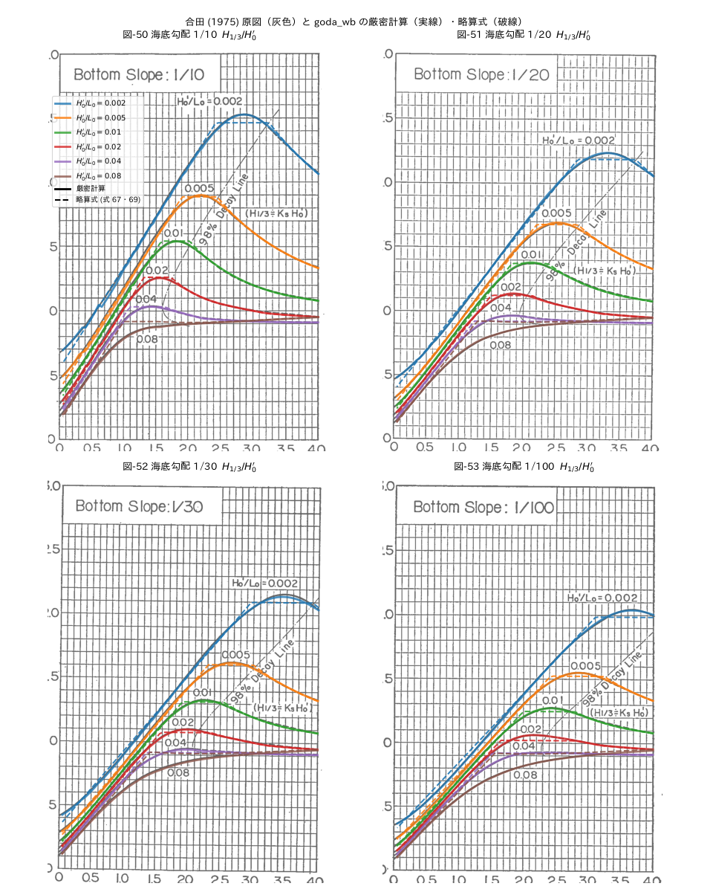
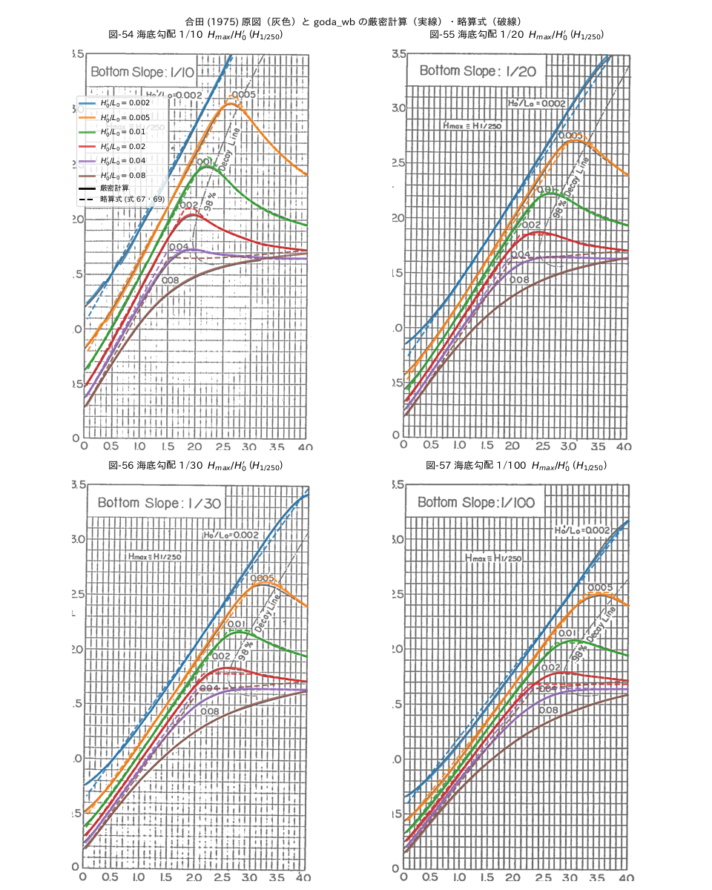

# goda-wb

合田の砕波変形モデル（Goda's breaking wave deformation model）を実装したPythonパッケージです。

## 概要

このパッケージは、合田の砕波変形モデルを用いて、浅水域における波の変形を計算します。代表波高（H1/1000, H1/250, H1/100, H1/50, H1/10, H1/5, H1/3）や浅水係数などを算出できます。

## インストール

```bash
# GitHub リポジトリから直接インストール
pip install git+https://github.com/tlasu/goda_wb.git

# または uv を使用
uv add git+https://github.com/tlasu/goda_wb.git
```

## 使用方法

### 基本的な使用例

```python
import goda_wb.core as core

# 海底勾配、波形勾配、水深波長比を指定して計算
tant = 0.01  # 海底勾配
h0l0 = 0.02  # 波形勾配（H0/L0）
dl0 = [0.4, 0.3, 0.2]  # 水深波長比（d/L0）のリスト

df = core.cal_surf_goda(tant, h0l0, dl0)
print(df)
```

### 有次元での計算

```python
# 沖波波高、周期、水深を指定して計算
H0 = 12.0  # 沖波波高 [m]
T = 12.0   # 周期 [s]
tant = 0.01  # 海底勾配

# デフォルトの水深波長比リストを使用
df = core.cal_surf_goda_dim(tant=tant, H0=H0, T=T, dim=True)

# 特定の水深を指定
d = 14.0  # 水深 [m]
df = core.cal_surf_goda_dim(tant=tant, H0=H0, T=T, d=d, dim=True)
```

### 単一点の計算

```python
# 単一の水深波長比での計算
df = core.cal_surf_goda_point(tant=0.01, h0l0=0.02, dl0=0.3)
```

### 浅水係数の計算

```python
# 浅水係数の計算
dl0 = 0.3  # 水深波長比
h0l0 = 0.02  # 波形勾配
aks = core.shoal(dl0, h0l0)
print(f"浅水係数: {aks}")
```

### 略算式による計算

```python
# 合田 (1975) の略算式 (式 67・69) による有義波高・最高波高
df = core.cal_surf_goda_approx(tant=0.01, h0l0=0.02, dl0=[0.1, 0.03, 0.01])
print(df[["dl0", "H1_3", "Hmax"]])
```

### 波長の計算

```python
# 波長の計算
d = 10.0  # 水深 [m]
T = 12.0  # 周期 [s]
L = core.cal_wave_length(d, T)
print(f"波長: {L} [m]")
```

## 主な機能

### `cal_surf_goda(tant, h0l0, dl0)`

合田の砕波変形モデルによる計算を実行します。

**パラメータ:**
- `tant`: 海底勾配
- `h0l0`: 波形勾配（H0/L0）
- `dl0`: 水深波長比（d/L0）のリスト、またはNone（デフォルト値を使用）。並び順は任意。
  セットアップは沖側から積み上げる必要があるため、指定した点が少なくても内部ではデフォルトの細かい計算点と合わせて沖側から計算し、指定点の結果を返します。

**戻り値:**
- `pandas.DataFrame`: 以下のカラムを含むデータフレーム
  - `H1_1000`, `H1_250`, `H1_100`, `H1_50`, `H1_10`, `H1_5`, `H1_3`: 各代表波高比
  - `dh0`: 水深波高比（h/H0）
  - `dl0`: 水深波長比（d/L0）
  - `etal0`: セットアップ高さ比
  - `aks`: 浅水係数

### `cal_surf_goda_dim(tant, H0, T, dim=False, d=None)`

有次元での計算を実行します。

**パラメータ:**
- `tant`: 海底勾配
- `H0`: 沖波波高 [m]
- `T`: 周期 [s]
- `dim`: Trueの場合、有次元の結果も含める
- `d`: 水深 [m]（単一値、リスト、またはNone）

### `cal_surf_goda_approx(tant, h0l0, dl0=None)`

合田 (1975) の略算式で砕波帯内の有義波高・最高波高を計算します。

- h/L0 ≥ 0.2: H1/3 = Ks·H0′, Hmax = 1.8 Ks·H0′
- h/L0 < 0.2: H1/3 = min{β0·H0′ + β1·h, βmax·H0′, Ks·H0′}, Hmax = min{β0*·H0′ + β1*·h, βmax*·H0′, 1.8 Ks·H0′}

係数 β は `approx_coef(tant, h0l0)` で取得できます（式 68・70）。原論文では β0* の係数が 0.52 と印刷されていますが、表-4 と一致する 0.052 を用いています。

**戻り値:** `H1_3`, `Hmax`（いずれも H0′ との比）, `dh0`, `dl0`, `aks` を含む DataFrame

### `shoal(dl0, h0l0)`

浅水変形の計算を行い、浅水係数を返します。

**パラメータ:**
- `dl0`: 水深波長比
- `h0l0`: 波形勾配

**戻り値:**
- `float`: 浅水係数

### `cal_wave_length(d, T)`

波長を計算します。

**パラメータ:**
- `d`: 水深 [m]
- `T`: 周期 [s]

**戻り値:**
- `float`: 波長 [m]

## 原図との比較

合田 (1975) の算定図（図-50〜53：有義波高、図-54〜57：最高波高 Hmax ≒ H1/250）に計算結果（実線）と略算式（破線）を重ねて比較できます。原図は港湾技術研究所報告 14(3) p.96〜97 のスキャン画像です。

```bash
cd sample && uv run python compare_goda1975.py
```





図-52（海底勾配 1/30）は図枠の下辺と縦軸の目盛が方眼より 0.03〜0.06 高く描かれているため、方眼を基準に重ねています。各曲線のピーク付近の値は原図と 0.03 以内で一致し、テスト（`test_cal_surf_goda_matches_goda1975_chart_*`）でも確認しています。

## 依存関係

- Python >= 3.11
- numpy >= 2.3.4
- pandas >= 2.3.3

## 開発

開発環境のセットアップ:

```bash
# 依存関係のインストール
#pip install -e ".[dev]"
```

テストの実行:

```bash
pytest
```

## ライセンス

MIT License（詳細は [LICENSE](LICENSE) を参照）

## 参考文献

- 合田良実, "浅海域における波浪の砕波変形", 港湾空港技術研究所報告, Vol. 14, No. 3, 1975. ([全文PDF](https://www.pari.go.jp/PDF/vol014-no03-03.pdf) / [書誌情報](https://www.pari.go.jp/1975/09/1975090140303.html))
