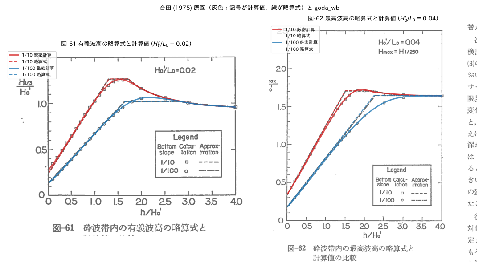
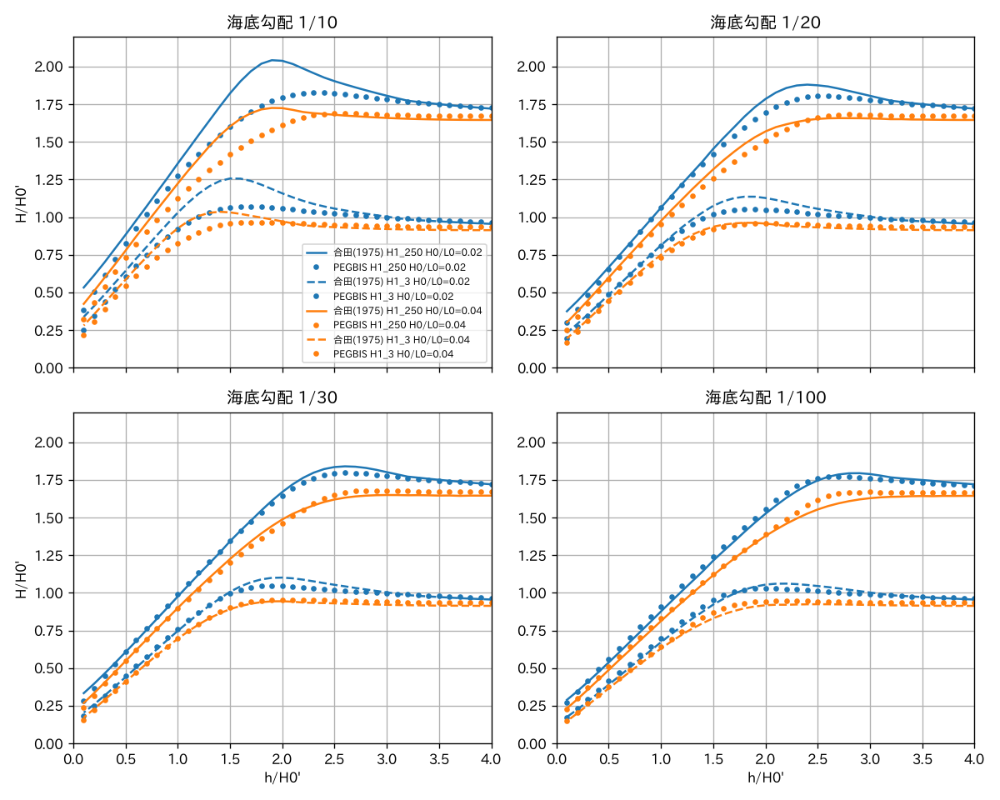
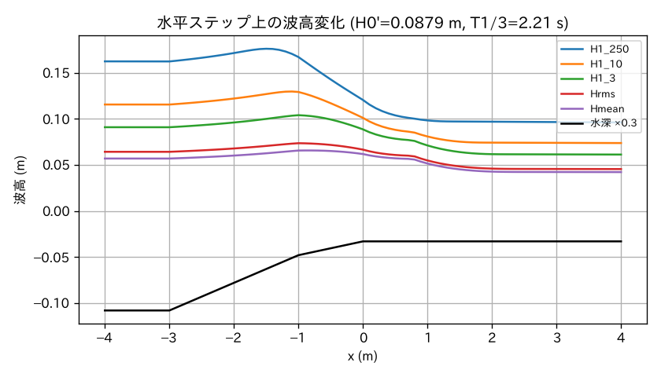

# goda-wb

合田の砕波変形モデル（Goda's breaking wave deformation model）を実装したPythonパッケージです。

## 概要

このパッケージは、合田の砕波変形モデルを用いて、浅水域における波の変形を計算します。代表波高（H1/1000, H1/250, H1/100, H1/50, H1/10, H1/5, H1/3）や浅水係数などを算出できます。

## インストール

```bash
# GitHub リポジトリから直接インストール
pip install git+https://github.com/tlasu/goda_wb.git

# または uv を使用
uv add git+https://github.com/tlasu/goda_wb.git
```

## 使用方法

### 基本的な使用例

```python
import goda_wb.core as core

# 海底勾配、波形勾配、水深波長比を指定して計算
tant = 0.01  # 海底勾配
h0l0 = 0.02  # 波形勾配（H0/L0）
dl0 = [0.4, 0.3, 0.2]  # 水深波長比（d/L0）のリスト

df = core.cal_surf_goda(tant, h0l0, dl0)
print(df)
```

### 有次元での計算

```python
# 沖波波高、周期、水深を指定して計算
H0 = 12.0  # 沖波波高 [m]
T = 12.0   # 周期 [s]
tant = 0.01  # 海底勾配

# デフォルトの水深波長比リストを使用
df = core.cal_surf_goda_dim(tant=tant, H0=H0, T=T, dim=True)

# 特定の水深を指定
d = 14.0  # 水深 [m]
df = core.cal_surf_goda_dim(tant=tant, H0=H0, T=T, d=d, dim=True)
```

### 単一点の計算

```python
# 単一の水深波長比での計算
df = core.cal_surf_goda_point(tant=0.01, h0l0=0.02, dl0=0.3)
```

### 浅水係数の計算

```python
# 浅水係数の計算
dl0 = 0.3  # 水深波長比
h0l0 = 0.02  # 波形勾配
aks = core.shoal(dl0, h0l0)
print(f"浅水係数: {aks}")
```

### 略算式による計算

```python
# 合田 (1975) の略算式 (式 67・69) による有義波高・最高波高
df = core.cal_surf_goda_approx(tant=0.01, h0l0=0.02, dl0=[0.1, 0.03, 0.01])
print(df[["dl0", "H1_3", "Hmax"]])
```

### 波高からの沖波波高の逆算

```python
# 勾配 1/50, 周期 10 s, 水深 5 m で H1/3 = 2.0 m となる沖波波高
H0 = core.cal_h0_from_height(tant=1 / 50, H=2.0, T=10.0, d=5.0)
print(f"沖波波高: {H0:.3f} [m]")  # 約 1.70 m
```

### 波長の計算

```python
# 波長の計算
d = 10.0  # 水深 [m]
T = 12.0  # 周期 [s]
L = core.cal_wave_length(d, T)
print(f"波長: {L} [m]")
```

## 主な機能

### `cal_surf_goda(tant, h0l0, dl0)`

合田の砕波変形モデルによる計算を実行します。

**パラメータ:**
- `tant`: 海底勾配
- `h0l0`: 波形勾配（H0/L0）
- `dl0`: 水深波長比（d/L0）のリスト、またはNone（デフォルト値を使用）。並び順は任意。
  セットアップは沖側から積み上げる必要があるため、指定した点が少なくても内部ではデフォルトの細かい計算点と合わせて沖側から計算し、指定点の結果を返します。

**戻り値:**
- `pandas.DataFrame`: 以下のカラムを含むデータフレーム
  - `H1_1000`, `H1_250`, `H1_100`, `H1_50`, `H1_10`, `H1_5`, `H1_3`: 各代表波高比
  - `dh0`: 水深波高比（h/H0）
  - `dl0`: 水深波長比（d/L0）
  - `etal0`: セットアップ高さ比
  - `aks`: 浅水係数

### `cal_surf_goda_dim(tant, H0, T, dim=False, d=None)`

有次元での計算を実行します。

**パラメータ:**
- `tant`: 海底勾配
- `H0`: 沖波波高 [m]
- `T`: 周期 [s]
- `dim`: Trueの場合、有次元の結果も含める
- `d`: 水深 [m]（単一値、リスト、またはNone）

### `cal_surf_goda_approx(tant, h0l0, dl0=None)`

合田 (1975) の略算式で砕波帯内の有義波高・最高波高を計算します。

- h/L0 ≥ 0.2: H1/3 = Ks·H0′, Hmax = 1.8 Ks·H0′
- h/L0 < 0.2: H1/3 = min{β0·H0′ + β1·h, βmax·H0′, Ks·H0′}, Hmax = min{β0*·H0′ + β1*·h, βmax*·H0′, 1.8 Ks·H0′}

係数 β は `approx_coef(tant, h0l0)` で取得できます（式 68・70）。原論文では β0* の係数が 0.52 と印刷されていますが、表-4 と一致する 0.052 を用いています。

**戻り値:** `H1_3`, `Hmax`（いずれも H0′ との比）, `dh0`, `dl0`, `aks` を含む DataFrame

### `cal_h0_from_height(tant, H, T, d, col="H1_3", approx=False)`

水深 `d` での波高 `H` から沖波波高 H0 [m] を逆算します。`cal_surf_goda`（`approx=True` の場合は `cal_surf_goda_approx`）の順計算を、H0 について数値的に解きます。

**パラメータ:**
- `tant`: 海底勾配
- `H`: 水深 `d` での波高 [m]
- `T`: 周期 [s]
- `d`: 水深 [m]
- `col`: `H` が表す代表波高（`H1_1000`〜`H1_3`。`approx=True` では `H1_3` または `Hmax`）
- `approx`: Trueの場合、略算式を用いる（高速）

**注意:** 砕波帯内では波高が沖波波高に対して頭打ちになるため、`H` のわずかな誤差で H0 が大きく変わります。波形勾配 H0/L0 = 0.0001〜0.1 の範囲で到達できない波高を指定すると `ValueError` になります。厳密計算では 1 回の逆算に 1 秒程度かかります。

### `shoal(dl0, h0l0)`

浅水変形の計算を行い、浅水係数を返します。

**パラメータ:**
- `dl0`: 水深波長比
- `h0l0`: 波形勾配

**戻り値:**
- `float`: 浅水係数

### `cal_wave_length(d, T)`

波長を計算します。

**パラメータ:**
- `d`: 水深 [m]
- `T`: 周期 [s]

**戻り値:**
- `float`: 波長 [m]

## 原図との比較

合田 (1975) の算定図（図-50〜53：有義波高、図-54〜57：最高波高 Hmax ≒ H1/250）に計算結果（実線）と略算式（破線）を重ねて比較できます。原図は港湾技術研究所報告 14(3) p.96〜97 のスキャン画像です。

```bash
cd sample && uv run python compare_goda1975.py
```


略算式については、論文の図-61・62（略算式と計算値の比較）も同じ条件で再現しています。原図の線（略算式）と記号（合田の計算値）に、それぞれ破線と実線が重なります。



略算式は論文自身が述べているとおり、波形勾配が大きいほど厳密計算より大きめになり（H0′/L0 = 0.04 で約 9%、0.08 で約 20%）、勾配 1/100 では βmax が 4% ほど小さめです。

図-52（海底勾配 1/30）は図枠の下辺と縦軸の目盛が方眼より 0.03〜0.06 高く描かれているため、方眼を基準に重ねています。各曲線のピーク付近の値は原図と 0.03 以内で一致し、テスト（`test_cal_surf_goda_matches_goda1975_chart_*`）でも確認しています。

## 段階的砕波変形モデル (PEGBIS)

`goda_wb.pegbis` は、合田 (2004) の段階的砕波変形モデル PEGBIS（ECOH/YG 技術論文 No.2, Ver.5）を岸沖方向 1 次元・直角入射に絞って実装したものです。合田 (1975) のモデル (`core`) は一様勾配斜面が前提ですが、PEGBIS は **バー・トラフ、水平ステップ、人工リーフなど任意の断面地形** を扱えます。

- 沖波をレイリー分布で等確率に分けた M 個（既定 831）の波高レベルごとに、微小振幅波の浅水変形と減衰を計算します
- 砕波減衰は式 (4)（α_b は付記の式 (付 1)）、砕波限界は波高レベルごとの段階的砕波係数 κm（式 (7)(8)、勾配 0 以下では式 (11) の κm'）、底面摩擦は式 (14) によります
- 局所海底勾配は沖側 L0/10 の点との水深差から求めます
- `n_freq` を 2 以上にすると、周波数スペクトルを式 (15) でエネルギーが等しい成分に分けます（修正 Bretschneider-光易型で Tp = 1.136 T1/3）
- 段階的砕波係数の定数 Cb は波高レベル数 M に応じて決め（M >= 300 で 0.080）、勾配 0 以下の Cb' は Cb に比例させます。論文は現地海岸への適用では `cb=0.070` を推奨しています
- ウェーブセットアップ、サーフビート、非線形浅水変形、屈折・回折は含みません

```python
import goda_wb.pegbis as pegbis

# 任意断面: 距離 x [m]（岸向きに増加）と水深 h [m]
x = [-200.0, -20.0, 0.0, 100.0]
h = [20.0, 4.0, 2.0, 2.0]  # 勾配斜面に続く水深 2 m の水平ステップ
df = pegbis.cal_surf_pegbis(x, h, H0=4.0, T=8.7, fw=0.01, n_freq=10)
print(df[["x", "h", "H1_250", "H1_3", "Hrms", "Hmean"]])

# 一様勾配斜面の無次元計算（合田 (1975) との比較用）
df = pegbis.cal_surf_pegbis_slope(tant=1 / 30, h0l0=0.02, dl0=[0.04, 0.02, 0.01])
```

`fw` は x と同じ長さの配列も指定でき、人工リーフの天端だけ摩擦係数を大きくする（論文では 0.15 程度）といった使い方ができます。Swart (1974) の摩擦係数は `pegbis.swart_fw(ks, am)` で求められます。

### 論文との比較

```bash
cd sample && uv run python compare_pegbis.py
```



論文の図-6〜9 と同様に、勾配 1/30, 1/100 では合田 (1975) のモデルとほぼ一致し、勾配 1/10, 1/20 では h/H0′ = 1.5〜2.5 付近で小さめになります。周波数スペクトルを使うと浅水係数の極小値は 0.937 で、論文の値と一致します。ただし勾配 1/10 では、論文の計算値より Hmax が最大 0.07 程度小さくなっています。



水平ステップ上の安定波高は、論文 図-11 の計算値より Hmax・H1/10・H1/3 で 5〜6%、Hrms・Hmean で 12〜14% 小さくなります。

## 依存関係

- Python >= 3.11
- numpy >= 2.3.4
- pandas >= 2.3.3

## 開発

開発環境のセットアップ:

```bash
# 依存関係のインストール
#pip install -e ".[dev]"
```

テストの実行:

```bash
pytest
```

## ライセンス

MIT License（詳細は [LICENSE](LICENSE) を参照）

## 参考文献

- 合田良実, "浅海域における波浪の砕波変形", 港湾空港技術研究所報告, Vol. 14, No. 3, 1975. ([全文PDF](https://www.pari.go.jp/PDF/vol014-no03-03.pdf) / [書誌情報](https://www.pari.go.jp/1975/09/1975090140303.html))
- 合田良実, "不規則波浪変形計算における段階的砕波係数の導入について (Ver.5)", ECOH/YG 技術論文 No.2, 2004. ([掲載ページ](https://www.ecoh.co.jp/goda/849/))
- 合田良実, "段階的砕波変形モデルによる人工リーフの波浪減殺特性の解析 (Ver.3)", ECOH/YG 技術論文 No.3, 2003. ([掲載ページ](https://www.ecoh.co.jp/goda/847/))
